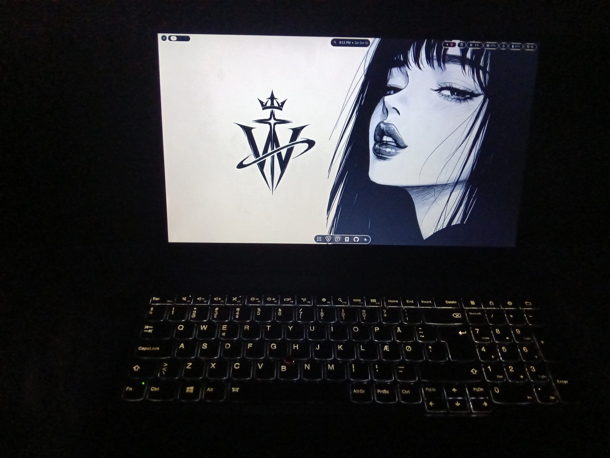
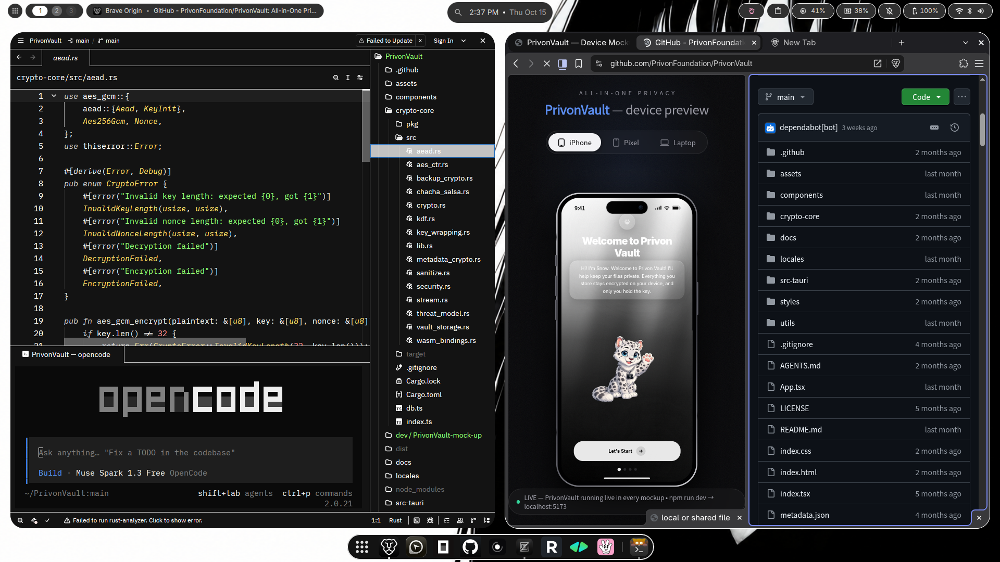

<!-- Profil GitHub · wtshex-ch -->

  <picture>
    <source media="(prefers-color-scheme: dark)" srcset="assets/emblem-white.png">
    <source media="(prefers-color-scheme: light)" srcset="assets/emblem-dark.png">
    
  </picture>

  <strong>Privon Foundation</strong> 
  <em>Self-taught in Cybersecurity, Privacy &amp; UI/UX AI</em>

---

### Workstation

  
  &nbsp;
  

---

### Technologies I develop and experiment with

  <picture>
    <source media="(prefers-color-scheme: dark)" srcset="https://img.shields.io/badge/TypeScript-fff?style=for-the-badge&logo=typescript&logoColor=000">
    
  </picture>
  <picture>
    <source media="(prefers-color-scheme: dark)" srcset="https://img.shields.io/badge/React-fff?style=for-the-badge&logo=react&logoColor=000">
    
  </picture>
  <picture>
    <source media="(prefers-color-scheme: dark)" srcset="https://img.shields.io/badge/Vite-fff?style=for-the-badge&logo=vite&logoColor=000">
    
  </picture>
  <picture>
    <source media="(prefers-color-scheme: dark)" srcset="https://img.shields.io/badge/Tailwind%20CSS-fff?style=for-the-badge&logo=tailwindcss&logoColor=000">
    
  </picture>
  <picture>
    <source media="(prefers-color-scheme: dark)" srcset="https://img.shields.io/badge/Tauri-fff?style=for-the-badge&logo=tauri&logoColor=000">
    
  </picture>
  <picture>
    <source media="(prefers-color-scheme: dark)" srcset="https://img.shields.io/badge/Rust-fff?style=for-the-badge&logo=rust&logoColor=000">
    
  </picture>
  <picture>
    <source media="(prefers-color-scheme: dark)" srcset="https://img.shields.io/badge/WASM-fff?style=for-the-badge&logo=webassembly&logoColor=000">
    
  </picture>
  <picture>
    <source media="(prefers-color-scheme: dark)" srcset="https://img.shields.io/badge/AES--256--GCM-fff?style=for-the-badge">
    
  </picture>
  <picture>
    <source media="(prefers-color-scheme: dark)" srcset="https://img.shields.io/badge/Argon2id-fff?style=for-the-badge">
    
  </picture>
  <picture>
    <source media="(prefers-color-scheme: dark)" srcset="https://img.shields.io/badge/OpenCode-fff?style=for-the-badge&logo=opencode&logoColor=000">
    
  </picture>
  <picture>
    <source media="(prefers-color-scheme: dark)" srcset="https://img.shields.io/badge/Claude%20Code-fff?style=for-the-badge&logo=claude&logoColor=000">
    
  </picture>

---

### Contributions & Stats

  <picture>
    <source media="(prefers-color-scheme: dark)" srcset="https://ghchart.rshah.org/ffffff/wtshex-ch">
    
  </picture>

  <picture>
    <source media="(prefers-color-scheme: dark)" srcset="https://github-readme-stats.vercel.app/api?username=wtshex-ch&show_icons=true&hide_border=true&bg_color=00000000&title_color=ffffff&text_color=ffffff&icon_color=ffffff&rank_icon=github">
    
  </picture>
  <picture>
    <source media="(prefers-color-scheme: dark)" srcset="https://github-readme-stats.vercel.app/api/top-langs/?username=wtshex-ch&layout=compact&hide_border=true&bg_color=00000000&title_color=ffffff&text_color=ffffff&langs_count=8">
    
  </picture>

  <picture>
    <source media="(prefers-color-scheme: dark)" srcset="https://streak-stats.demolab.com?user=wtshex-ch&hide_border=true&background=00000000&stroke=ffffff&ring=ffffff&fire=ffffff&currStreakLabel=ffffff&sideLabels=ffffff&dates=ffffff&currStreakNum=ffffff&sideNums=ffffff">
    
  </picture>

