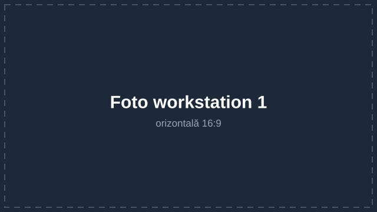
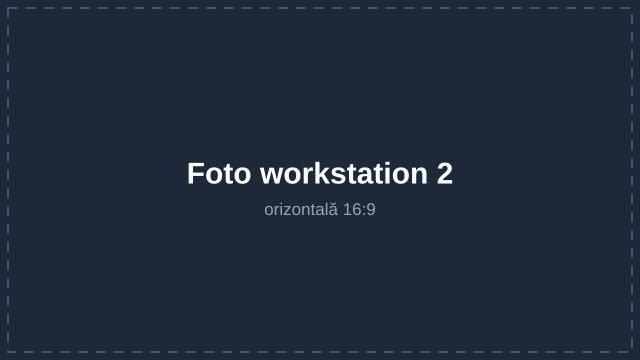

<!-- Profil GitHub · wtshex-ch -->

  <picture>
    <source media="(prefers-color-scheme: dark)" srcset="assets/emblem-white.png">
    <source media="(prefers-color-scheme: light)" srcset="assets/emblem-dark.png">
    
  </picture>

  <strong>Privon Foundation</strong> 
  <em>Self-taught in Cybersecurity, Privacy &amp; UI/UX AI</em>

---

## 🖥️ Workstation

  
  &nbsp;
  

